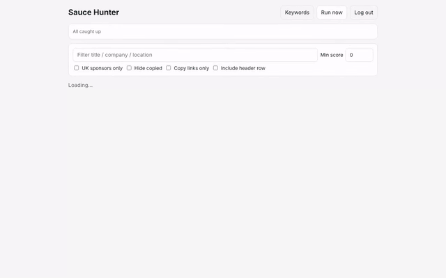

# Sauce Hunter

**A daily job radar you host yourself, for free.**

<p>
  <a href="https://zippedsauce.dev/projects/sauce-hunter/?ref=sauce-hunter"><strong>Project page</strong></a> ·
  <a href="#setup-once">Run your own</a> ·
  <a href="https://vercel.com/new/clone?repository-url=https%3A%2F%2Fgithub.com%2Fhassixmalik%2Fsauce-hunter&env=CRON_SECRET,BASIC_AUTH_USER,BASIC_AUTH_PASS,TIMEZONE&envDescription=Login%2C%20cron%20secret%20and%20your%20time%20zone.%20See%20.env.example&envLink=https%3A%2F%2Fgithub.com%2Fhassixmalik%2Fsauce-hunter%2Fblob%2FHEAD%2F.env.example&project-name=sauce-hunter">Deploy to Vercel</a>
</p>



Once a day it pulls new jobs from public job APIs, keeps the ones that match your keywords, scores them, stores each job
once (Neon Postgres) and shows them grouped by day. Each day has a **Copy as CSV** button (tab-separated, so it pastes
straight into Google Sheets columns) and is then marked **Copied ✓**, so you never paste the same jobs twice.

> **Not a service.** There is no sign-up and nothing to subscribe to. You deploy your own copy, with your own keywords
> and your own database. Your login, keys and data live in your Vercel project, never in this repo.

The whole thing is one daily serverless function plus five small tables, so it stays inside the free tiers (Vercel Hobby + Neon free).
It works with **no API keys at all**: Arbeitnow and the Greenhouse / Lever / Ashby company boards are public. Adzuna and Reed are optional extras.

## Features

- Daily fetch from Arbeitnow, Greenhouse, Lever and Ashby boards (plus Adzuna and Reed with free keys).
- Keyword scoring you edit in the browser: include, exclude and weighted boost terms, CSV import and export.
- UK visa sponsor flag, checked against the government's licensed sponsor register.
- Each job stored once across sources and days, grouped by the day it was found.
- Copy a day as CSV for your sheet, phone friendly, installable as an app.

## Setup (once)

1. **Vercel**: fork this repo and import it at vercel.com/new (Next.js is auto-detected), or use the **Deploy to Vercel** link above.
2. **Database**: in the Vercel project, go to *Storage → Marketplace → Neon* and connect it. This adds `DATABASE_URL`.
3. **Tables**: created automatically on the first request. (Optional manual way: copy `DATABASE_URL` and run)
   ```bash
   DATABASE_URL="postgres://..." npm run db:init
   ```
   (or paste `db/schema.sql` into the Neon SQL editor).
4. **Env vars** (Project → Settings → Environment Variables), see `.env.example`:
   - `TIMEZONE`: your IANA time zone, e.g. `Europe/London`. It decides which day a job belongs to. Default `UTC`.
   - `CRON_SECRET`: any long random string. Vercel sends it to the cron routes automatically.
   - `BASIC_AUTH_USER` / `BASIC_AUTH_PASS`: the login for the site. **Required**; the site returns 500 without them in production.
   - `ADZUNA_APP_ID` / `ADZUNA_APP_KEY` (free at developer.adzuna.com), `REED_API_KEY` (free at reed.co.uk/developers).
     Optional: without them those sources are skipped and the company boards still run.
5. Redeploy. Open the site, log in, then press **Run now**. Open **Run details** → **Refresh sponsors** once to load the UK sponsor register.

Crons (`vercel.json`): jobs daily at 03:00 UTC, sponsor register every Monday at 02:00 UTC. Change the times there.

## Daily use (phone friendly)

- Open the site. The first day with new jobs is already expanded.
- **Copy as CSV**: copies the visible, not-yet-copied jobs and marks them copied. Paste into the sheet.
- **Mark copied**: marks the day without copying (e.g. if you exported another way). **Undo copied** reverts it.
- **Download .csv**: comma-separated file of the whole day.
- Filters (saved on your device): search, min score, UK sponsors only, hide copied, links only, include header row.
- Tip: on iPhone use *Share → Add to Home Screen*; on Android use *Install app* to get an app icon.

## Letting Claude fetch the list for you

Everything except the cron routes uses Basic Auth:

```bash
curl -u "$BASIC_AUTH_USER:$BASIC_AUTH_PASS" "https://<app>/api/jobs?format=csv&only=new"
```

```bash
curl -u "$BASIC_AUTH_USER:$BASIC_AUTH_PASS" -X POST "https://<app>/api/batches/2026-11-08/copied"
```

| Route | What |
|---|---|
| `GET /api/jobs?date=YYYY-MM-DD&format=json\|csv\|tsv&only=new&links=1&header=0&download=1` | A day's jobs, score desc. No date = oldest day that still has uncopied jobs |
| `GET /api/batches` | Days with `job_count`, `new_count`, `copied_at` |
| `POST /api/batches/:date/copied` | Mark the day copied (body `{ "ids": [..] }` to mark only some). `DELETE` un-marks it |
| `GET /api/runs` | Last 10 runs with per-source stats |
| `POST /api/run` | Run the fetch now (`?what=sponsors` refreshes the sponsor list) |
| `GET/POST /api/keywords`, `PATCH/DELETE /api/keywords/:id`, `GET /api/keywords/export`, `POST /api/keywords/reset` | Keyword manager |
| `GET /api/rescore` (preview last 7 days), `POST /api/rescore?date=` (rescore a day) | Re-scoring |

Trigger the cron by hand:

```bash
curl -H "Authorization: Bearer $CRON_SECRET" https://<app>/api/cron/fetch
```

## Tuning

- **Keywords**: edit them at `/keywords` (add, comma-separated add, CSV/TXT upload, toggle, delete, export, reset).
  Defaults and the score threshold (35) are in `config/scoring.ts`. Changes apply from the next run; press **Rescore today** to re-score saved jobs.
  - *Include*: the title must match one. *Exclude*: the title is dropped if it matches one.
  - *Boost*: adds the weight when the term is in the chosen field. **Terms with the same field and weight form a group that counts once**
    (so "Applied AI / ML Engineer" gets +25, not +75).
  - Fixed rules (in `config/scoring.ts`): +5 for mid-level/no seniority word, +15 for UK sponsor register or "visa sponsorship" text, −30 for "no sponsorship"/"must have right to work".
- **Companies**: `config/companies.ts` (Greenhouse / Lever / Ashby slugs). A wrong slug only shows as an error in Run details.
- **New default keywords** (after editing `config/scoring.ts`): `curl -H "Authorization: Bearer $CRON_SECRET" https://<app>/api/cron/keywords` adds the missing ones and keeps your edits. Note: it also re-adds any default you deleted, so turn those off (◉) instead of deleting.
- **Searches**: `config/searches.ts` (Adzuna countries + queries, Reed queries + locations, Arbeitnow on/off).

## Notes

- Dedupe: URLs are cleaned of tracking params, and `url` and `dedupe_key` (company|title|location) are both unique, so a job is stored once across sources and days.
- `batch_date` uses the calendar day in `TIMEZONE`.
- Non-UK jobs have `sponsor_uk = null`; UK jobs are `true`/`false` once the register is loaded.
- No scraping of LinkedIn/Indeed/Glassdoor; only official/public APIs.

## Dev

```bash
npm install
```

```bash
npm test
```

```bash
cp .env.example .env.local && npm run dev
```

## License

MIT. See [LICENSE](./LICENSE).

---

<p align="center">
  <a href="https://zippedsauce.dev/?ref=sauce-hunter"></a><br>
  <sub>Made by <a href="https://zippedsauce.dev/?ref=sauce-hunter">zippedsauce</a> · small, free tools · <a href="https://zippedsauce.dev/#catalog">more tools</a></sub>
</p>
